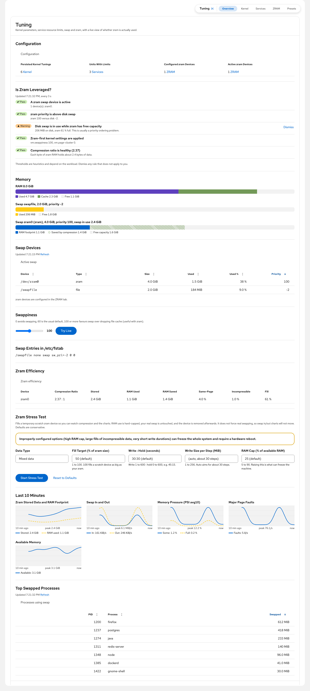
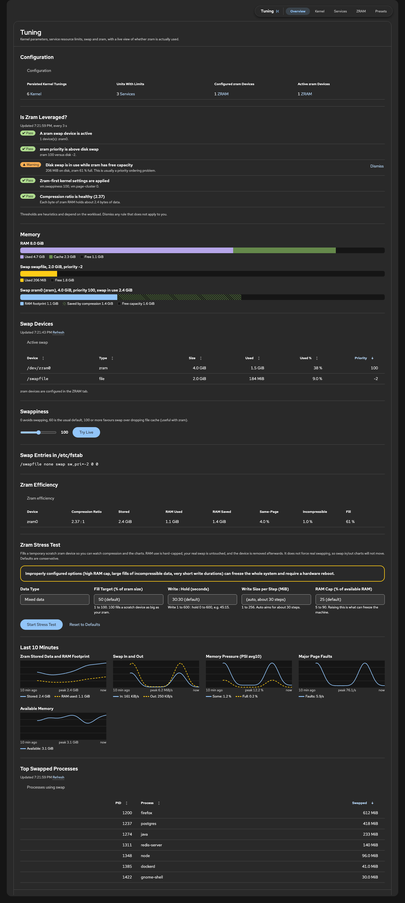
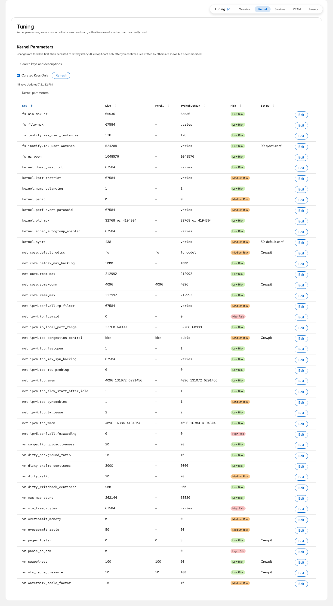
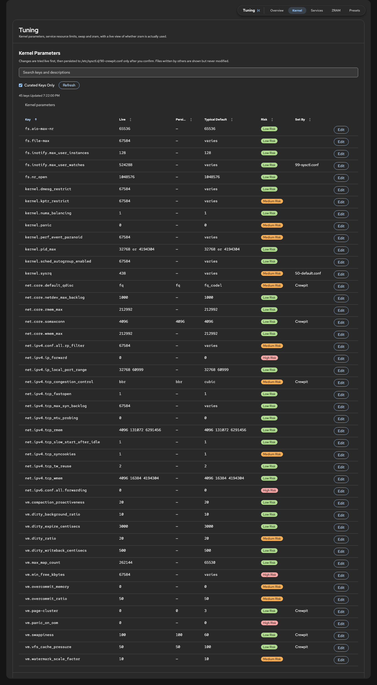
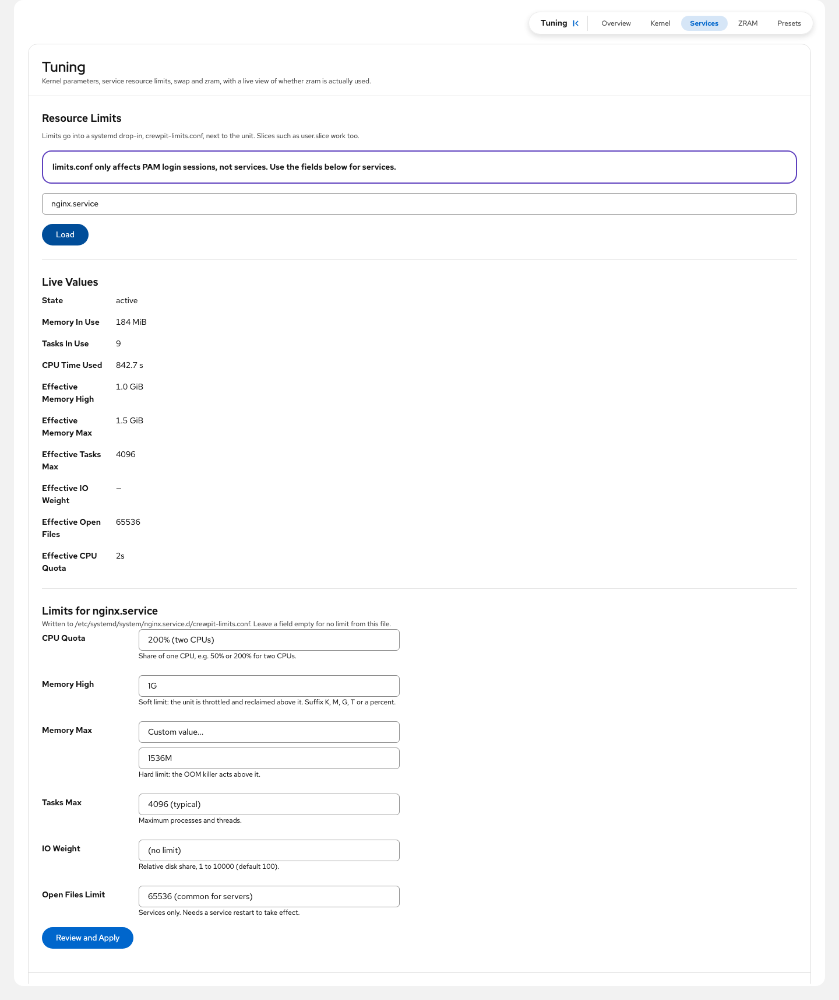
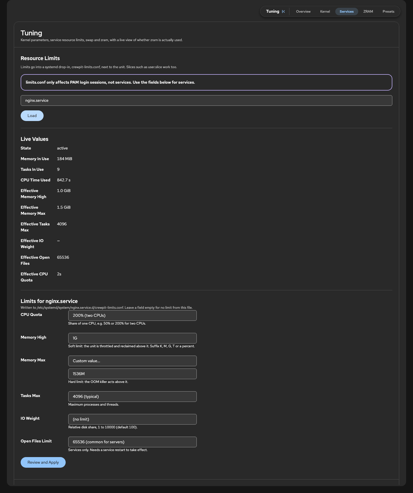
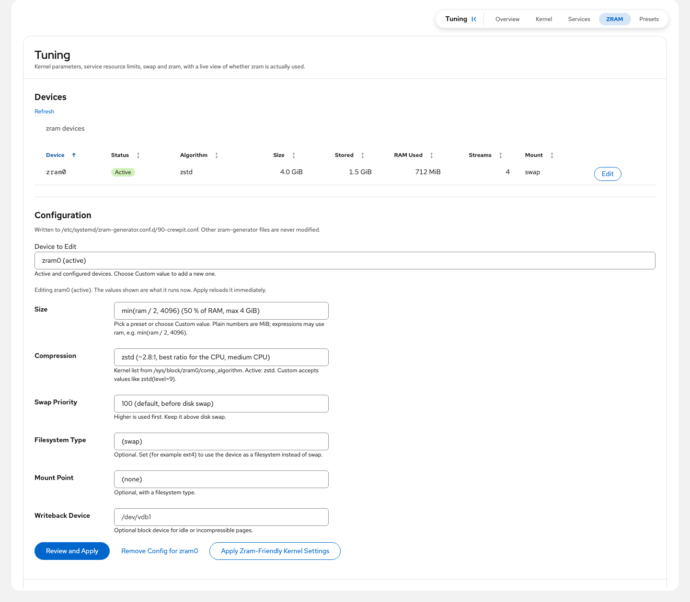
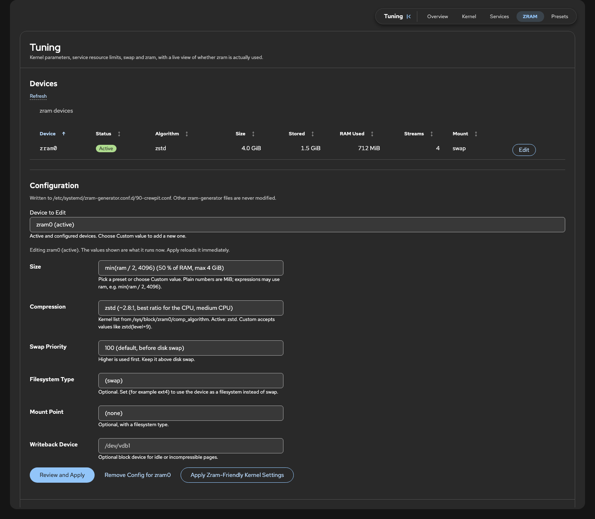
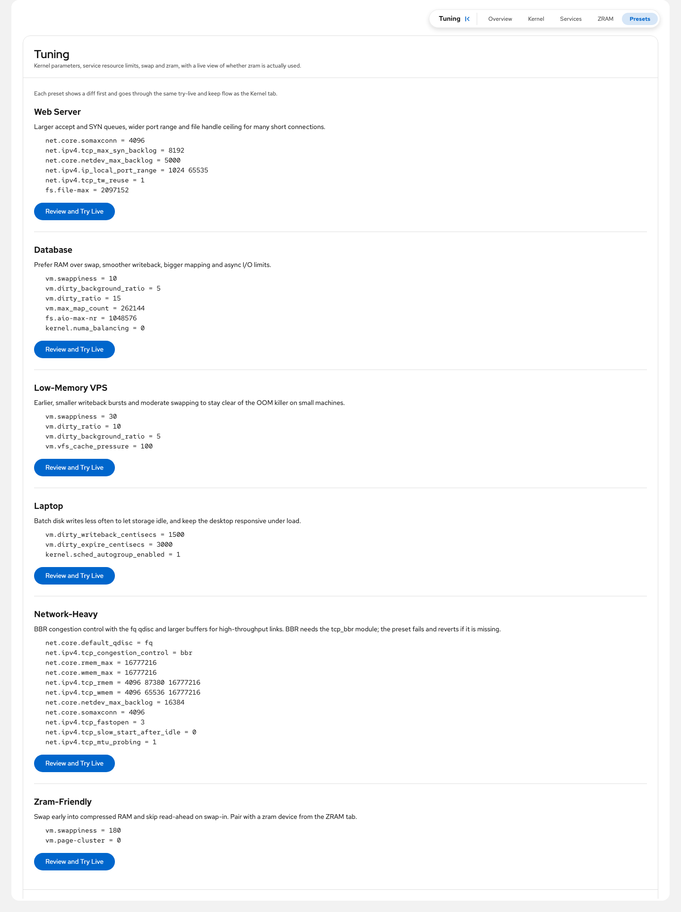
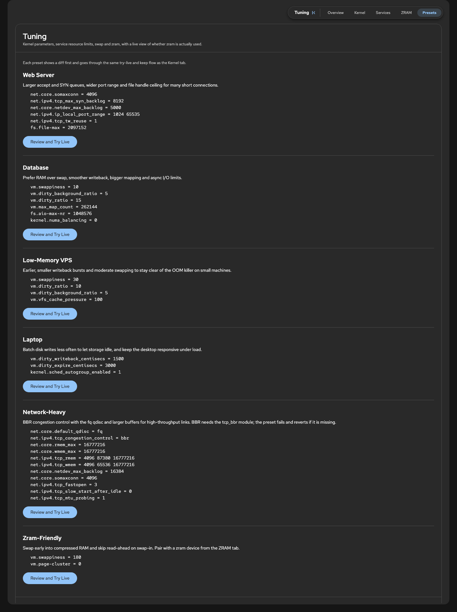

# cockpit-tuning

A Cockpit tool page for kernel tuning, per-service resource limits and zram, with a live view that shows whether the tuning actually makes use of zram. Requires no build step: just static HTML/CSS/JS dropped into a Cockpit package directory. Built from [Crewdriver](https://github.com/Crewpit/crewdriver) and installable with [Crewmate](https://github.com/Crewpit/crewmate).

The value is the **configured versus effective** view and safe apply, not a text editor. Tuning settings are scattered across `/etc/sysctl.d`, systemd drop-ins, `zram-generator` config and `/sys`; Cockpit has no UI for any of it.

## Layout

- **Overview**: everything at a glance: counts of persisted tunings, limited units and zram devices, the "is zram leveraged?" checklist, memory and zram bars, swap devices and swappiness, fstab swap entries, zram efficiency, a zram stress test (`stress-zram.sh`, scratch device, hard RAM cap, configurable fill, durations, step size and cap), a 10 minute time-series (swap in/out, zram data and RAM footprint, PSI, major faults, available memory) and top swapped processes.
- **Kernel**: curated sysctl catalogue (about 45 keys) and search over every key. Live, Persisted and Typical Default columns. Changes are tried live first with a 60 second keep-or-revert window, and persisted to `/etc/sysctl.d/90-crewpit.conf` only after you confirm.
- **Services**: per-unit and per-slice `CPUQuota`, `MemoryHigh`, `MemoryMax`, `TasksMax`, `IOWeight`, `LimitNOFILE`, written as `crewpit-limits.conf` drop-ins.
- **ZRAM**: `systemd-zram-generator` devices: size, algorithm, priority, filesystem, writeback. Blocks a restart when the swapped data would not fit back into free RAM. Warns about priority, zswap and size conflicts.
- **Presets**: Web Server, Database, Low-Memory VPS, Laptop, Network-Heavy, Zram-Friendly, applied through the same diff and try-live flow.

Safe-apply rules: only our own drop-in files are written, a timestamped backup (last 5 kept) is taken before every write, the result is validated, and on failure the backup is restored and stderr is shown.

## Screenshots

| | Light | Dark |
| --- | --- | --- |
| Overview |  |  |
| Kernel |  |  |
| Services |  |  |
| ZRAM |  |  |
| Presets |  |  |

## Installing

The target machine needs Cockpit 175 or newer and the commands listed in `preflight.json`: `sysctl`, `systemctl`, `swapon`, `zramctl`, `grep`, `xargs`, `getconf`, `cp`, `mkdir`, `rm`, `ls`, `dd`, `head`, `tail`, `cat`, `sleep`, `yes`, `modprobe`, `udevadm`. The ZRAM tab also needs `systemd-zram-generator` (apt) or `zram-generator` (dnf); the page shows an install hint when it is missing.

### Recommended: Crewmate

Try [Crewmate](https://github.com/Crewpit/crewmate) first. It is the recommended package manager for Crewpit apps and can install **cockpit-tuning** straight from this repository, [Crewpit/cockpit-tuning](https://github.com/Crewpit/cockpit-tuning).

### Manual

Get the code, then copy it into `/usr/share/cockpit/cockpit-tuning` on the machine you want to tune:

```
git clone https://github.com/Crewpit/cockpit-tuning
cd cockpit-tuning
```

With `rsync` (needs `rsync` on both ends):

```
rsync -rvh --exclude .git --exclude screenshots ./ root@<host>:/usr/share/cockpit/cockpit-tuning/
```

Or with `scp`:

```
scp -r . root@<host>:/usr/share/cockpit/cockpit-tuning
```

If you are already on the target machine, `cp -r . /usr/share/cockpit/cockpit-tuning` as root does the same.

Reload Cockpit in the browser and **Tuning** shows up in the sidebar under Tools. Cockpit lists a package's files when you log in, so after adding a new file (not just editing one), log out and back in or it will 404.

To update, pull the latest changes and copy them over again.
